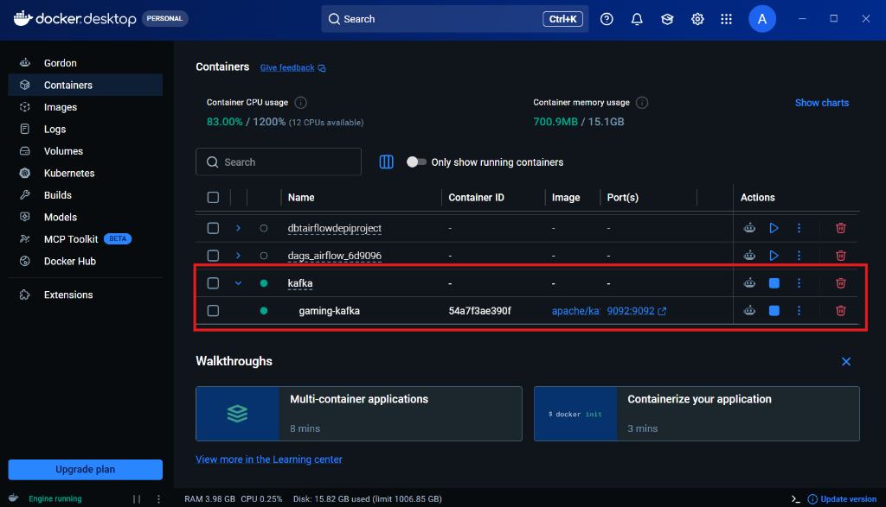
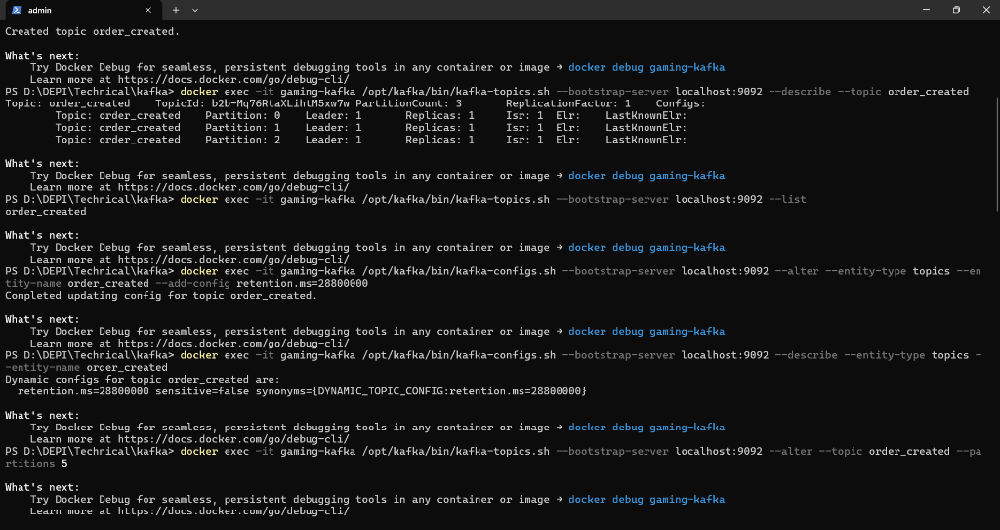
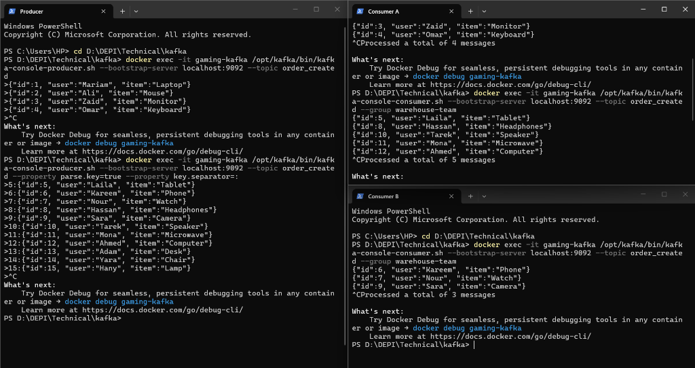
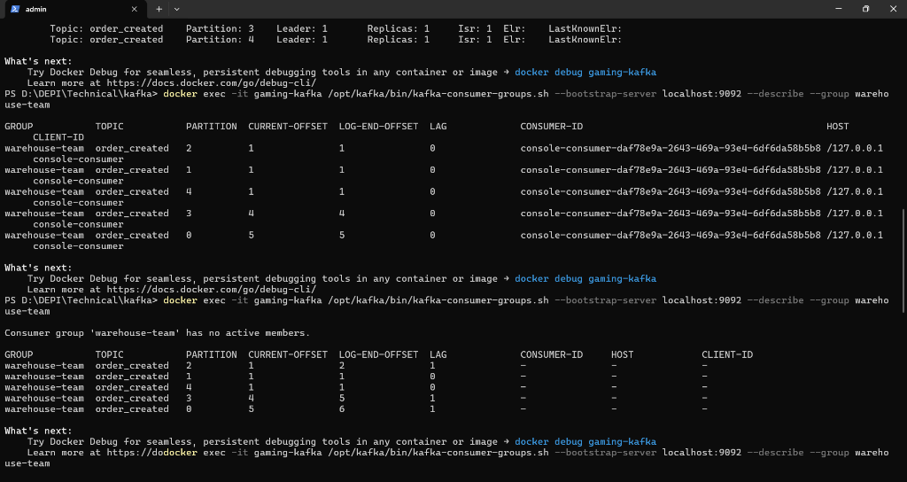

# Apache Kafka Hands-On Lab: E-Commerce Flow Simulation

## Overview

This repository documents a hands-on implementation of an Apache Kafka event streaming pipeline simulating an e-commerce order processing workflow. The environment runs Apache Kafka 4.0.1 in KRaft mode (broker and controller unified, without ZooKeeper) inside a Docker container.

The lab focuses on topic administration, runtime configuration adjustments, horizontal partition scaling, consumer group load balancing with keyed events, and consumer group offset and lag monitoring.

---

## Lab Environment

The cluster was initiated using Docker Compose with a single Apache Kafka service (`gaming-kafka`) running Kafka 4.0.1 in KRaft mode.

- **Broker Address:** `localhost:9092`
- **Controller Quorum:** Native KRaft quorum
- **Container Name:** `gaming-kafka`
- **Volume:** `kafka_data`

### Starting the Cluster

```powershell
docker compose up -d
docker compose ps
```

The container healthcheck confirms that the broker is ready and accepting requests.



---

## Step 1: Infrastructure and Topic Creation

A topic named `order_created` was created with 3 partitions and a replication factor of 1.

```powershell
docker exec -it gaming-kafka /opt/kafka/bin/kafka-topics.sh `
  --bootstrap-server localhost:9092 `
  --create --topic order_created `
  --partitions 3 --replication-factor 1
```

Verification of topic layout:

```powershell
docker exec -it gaming-kafka /opt/kafka/bin/kafka-topics.sh `
  --bootstrap-server localhost:9092 `
  --describe --topic order_created
```

Listing all active topics on the broker:

```powershell
docker exec -it gaming-kafka /opt/kafka/bin/kafka-topics.sh `
  --bootstrap-server localhost:9092 --list
```

---

## Step 2: Zero-Downtime Topic Scaling and Configuration

Administrative updates were executed against the live cluster without stopping running producers or brokers.

### 1. Dynamic Retention Policy Update

Set message retention to 8 hours (28,800,000 ms):

```powershell
docker exec -it gaming-kafka /opt/kafka/bin/kafka-configs.sh `
  --bootstrap-server localhost:9092 `
  --alter --entity-type topics --entity-name order_created `
  --add-config retention.ms=28800000
```

Confirming the dynamic override:

```powershell
docker exec -it gaming-kafka /opt/kafka/bin/kafka-configs.sh `
  --bootstrap-server localhost:9092 `
  --describe --entity-type topics --entity-name order_created
```

### 2. Increasing Partitions

Scaled the topic from 3 partitions to 5 partitions:

```powershell
docker exec -it gaming-kafka /opt/kafka/bin/kafka-topics.sh `
  --bootstrap-server localhost:9092 `
  --alter --topic order_created --partitions 5
```

Validating the updated partition count and retention configuration:

```powershell
docker exec -it gaming-kafka /opt/kafka/bin/kafka-topics.sh `
  --bootstrap-server localhost:9092 `
  --describe --topic order_created
```

The topic details confirmed `PartitionCount: 5` (partitions 0 through 4) and `retention.ms=28800000`.



---

## Step 3: Event Production and Consumer Streaming

Order events were sent to `order_created` in JSON format using the console producer:

```powershell
docker exec -it gaming-kafka /opt/kafka/bin/kafka-console-producer.sh `
  --bootstrap-server localhost:9092 `
  --topic order_created
```

Sample messages produced:
```json
{"id":1, "user":"Mariam", "item":"Laptop"}
{"id":2, "user":"Ali", "item":"Mouse"}
{"id":3, "user":"Zaid", "item":"Monitor"}
```

A console consumer was launched to read the complete log from offset zero:

```powershell
docker exec -it gaming-kafka /opt/kafka/bin/kafka-console-consumer.sh `
  --bootstrap-server localhost:9092 `
  --topic order_created --from-beginning
```

A subsequent message (`{"id":4, "user":"Omar", "item":"Keyboard"}`) produced from the producer appeared immediately in the consumer terminal, demonstrating live event streaming.

---

## Step 4: Consumer Groups and Load Balancing

To simulate parallel downstream processing (e.g., warehouse fulfillment), multiple consumers were configured under a shared consumer group (`warehouse-team`).

### 1. Keyed Message Production

The producer was configured to include message keys (`key:value`), ensuring deterministic routing where messages sharing the same key land on the same partition:

```powershell
docker exec -it gaming-kafka /opt/kafka/bin/kafka-console-producer.sh `
  --bootstrap-server localhost:9092 `
  --topic order_created `
  --property parse.key=true --property key.separator=:
```

### 2. Consumer Group Execution

Two consumer instances joined the group `warehouse-team`:

- **Consumer A (Terminal 3):**
  ```powershell
  docker exec -it gaming-kafka /opt/kafka/bin/kafka-console-consumer.sh `
    --bootstrap-server localhost:9092 `
    --topic order_created --group warehouse-team
  ```

- **Consumer B (Terminal 4):**
  ```powershell
  docker exec -it gaming-kafka /opt/kafka/bin/kafka-console-consumer.sh `
    --bootstrap-server localhost:9092 `
    --topic order_created --group warehouse-team
  ```

### Observations
- Kafka distributed the 5 partitions between Consumer A and Consumer B.
- Consumer A received messages: 5 (Laila), 8 (Hassan), 10 (Tarek), 11 (Mona), 12 (Ahmed).
- Consumer B received messages: 6 (Kareem), 7 (Nour), 9 (Sara).
- Terminating Consumer B triggered a group rebalance; subsequent orders routed to Consumer A, which took ownership of all assigned partitions without service interruption.



---

## Step 5: Consumer Group Monitoring and Lag Detection

Consumer lag represents the delta between the latest message published (`LOG-END-OFFSET`) and the latest message read by the group (`CURRENT-OFFSET`):

$$\text{LAG} = \text{LOG-END-OFFSET} - \text{CURRENT-OFFSET}$$

### 1. Active Inspection (Zero Lag)

With consumers actively processing messages:

```powershell
docker exec -it gaming-kafka /opt/kafka/bin/kafka-consumer-groups.sh `
  --bootstrap-server localhost:9092 `
  --describe --group warehouse-team
```

All partitions reflected `LAG = 0`, indicating real-time throughput.

### 2. Failure Simulation and Lag Accumulation

1. Stopped all active consumers in `warehouse-team`.
2. Produced new keyed orders (IDs: 13, 14, 15) while no consumers were running.
3. Inspected group status again:

```powershell
docker exec -it gaming-kafka /opt/kafka/bin/kafka-consumer-groups.sh `
  --bootstrap-server localhost:9092 `
  --describe --group warehouse-team
```

The output indicated:
- `Consumer group 'warehouse-team' has no active members.`
- Non-zero `LAG` on partitions holding pending messages.

### 3. Recovery via Committed Offsets

Restarting the consumer in `warehouse-team` resumed processing strictly from the committed offsets stored in the internal `__consumer_offsets` topic, consuming only pending messages (13, 14, 15) and returning `LAG` to 0.

Listing registered consumer groups on the broker:

```powershell
docker exec -it gaming-kafka /opt/kafka/bin/kafka-consumer-groups.sh `
  --bootstrap-server localhost:9092 --list
```



---

## Step 6: Resource Cleanup

1. Stopped running producer and consumer processes (`Ctrl+C`).
2. Deleted the topic `order_created`:

```powershell
docker exec -it gaming-kafka /opt/kafka/bin/kafka-topics.sh `
  --bootstrap-server localhost:9092 `
  --delete --topic order_created
```

3. Stopped containers and removed Docker volumes:

```powershell
docker compose down -v
```
